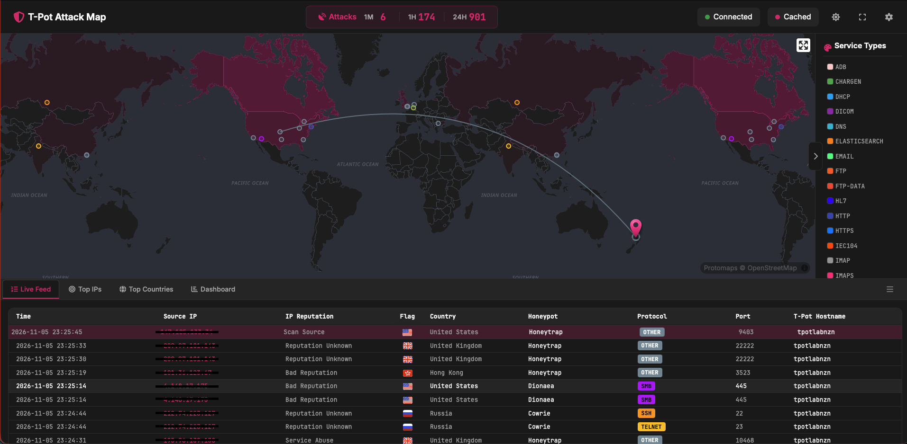
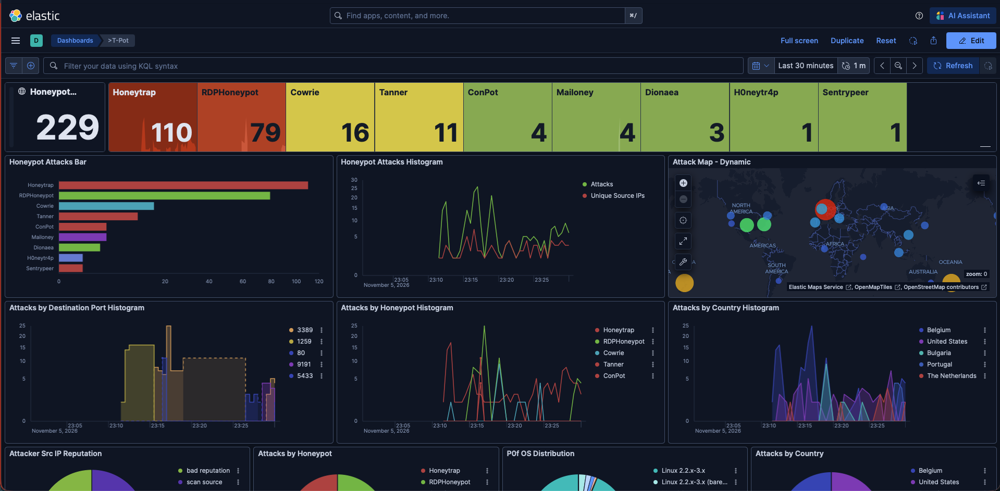
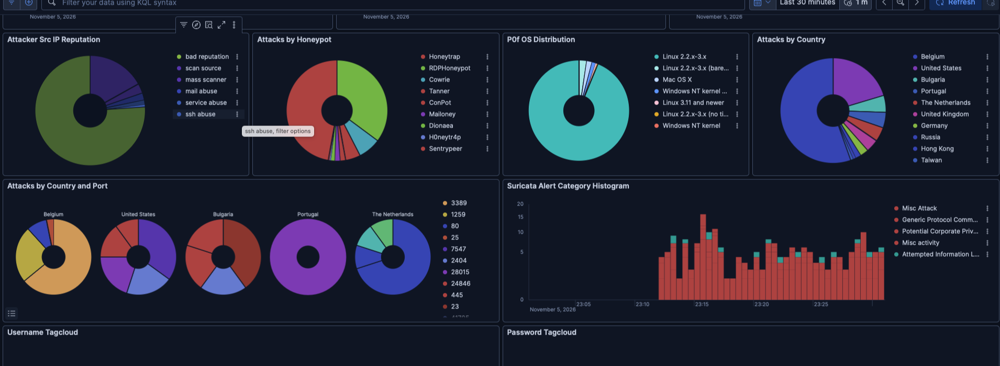
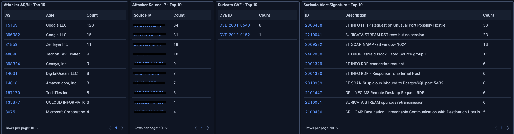

[](https://www.terraform.io/)
[](https://registry.terraform.io/providers/hashicorp/azurerm/latest)

---

## Why expose a VM to the internet?

A newly created VM can start receiving connection attempts as soon as it has a public IP and reachable services. It does not need to be advertised or known to users. In this lab, a **honeypot** is a decoy system or service intentionally exposed to record activity. It lets us observe interactions that reach the sensor, although those records do not tell us who initiated them or what happened beyond it.

I use **Terraform** to create an Azure Linux VM and **T-Pot Community Edition**, a platform that brings together honeypots and analysis tools. The goal is to see what reaches an exposed VM and understand why network controls matter. This is a temporary learning lab, not a production monitoring platform or a place to store sensitive data.

The timing and volume of events are not guaranteed. They depend on exposure, routing, available services, and chance. Terraform also finishes provisioning before T-Pot is installed. Start the observation period only after cloud-init completes, the VM reboots, and the web interface is ready.

## What we will learn

- How Terraform and cloud-init work together to create and configure the sensor.
- How the network rules expose honeypot services while restricting administrative access.
- How to inspect T-Pot events without confusing an attempt with a confirmed compromise.
- How to tear down the lab when the experiment is complete.

## Prerequisites and cost

You will need:

- Terraform `1.14.0` or later;
- an Azure subscription and permission to create a resource group, network resources, a public IP, and a VM;
- Azure authentication configured for the intended subscription;
- outbound internet access from the VM so it can download the T-Pot repository and container images.

Check regional availability and estimate costs before deploying. The default configuration uses a `Standard_D4s_v5` VM with 16 GB of memory and a 256 GB Premium SSD. The VM, disk, and public IP may incur charges while they remain provisioned; also consider storage and network usage during the lab.

## How the architecture works

Terraform describes and creates the Azure resources. On the VM's first boot, cloud-init runs inside the guest operating system and installs T-Pot.

```text
Terraform
└── Resource group
    ├── Network and security rules
    ├── Public IP
    └── Ubuntu VM
        └── cloud-init
            ├── installs prerequisites
            ├── clones the T-Pot repository
            ├── runs the unattended Hive installer
            ├── validates Docker Compose and pulls images
            └── reboots after successful installation
```

The resource group keeps the lab together. The network rules determine what can reach the VM, while the public IP makes the selected services reachable from outside Azure. Terraform creates the VM and passes it the cloud-init configuration; cloud-init then installs T-Pot inside the guest. The deployment also configures SSH key access, with password authentication disabled.

## The most important security decision: network exposure

A VM with a public IP and reachable services can be discovered by automated scanners. To observe activity on T-Pot, this lab deliberately allows inbound traffic from any source, using any protocol, on ports `1-64000`.

> **This is a broad, intentional rule for this honeypot. Do not copy it to a regular VM or production environment.**

In HCL, the rule that makes the honeypot services reachable looks like this:

```hcl
security_rule {
  name                       = "AllowHoneypotInbound"
  priority                   = 200
  direction                  = "Inbound"
  access                     = "Allow"
  protocol                   = "*"
  source_port_range          = "*"
  destination_port_range     = "1-64000"
  source_address_prefix      = "*"
  destination_address_prefix = "*"
}
```

The `*` source means any address; `protocol = "*"` does not limit the rule to TCP. The destination port range is specific to this T-Pot configuration. Administrative ports `64294`, `64295`, and `64297` are outside that range and have separate, higher-priority rules: first, allow the configured management CIDRs; then deny those ports to other sources.

If `management_source_address_prefixes` is not set, Terraform queries the public IP of the machine running `apply` and allows that address as a `/32`. Other sources are denied on the management ports. If you run Terraform from a different network than the one you will use to access T-Pot, explicitly set the management CIDRs. The NSG also permits all outbound traffic, which helps the VM download its components but is another broad choice specific to this lab.

This separation matters: the traffic we want to observe should not make the web interface and SSH available to everyone. An NSG controls network reachability; it does not patch the operating system or guarantee that a service is safe. For a regular VM, allow only required ports, restrict administration to a trusted network or VPN, keep the system updated, monitor the workload, and avoid exposing unnecessary services.

## Provision the infrastructure

From the root of the Terraform project, initialize the providers, validate the configuration, and review the plan before creating resources:

```bash
terraform init
terraform validate
terraform plan
terraform apply
```

`init` downloads the declared providers. `validate` checks configuration consistency and syntax; it does not confirm regional SKU availability, quota, or cost. `plan` shows the changes Terraform intends to make, so use it to check the subscription, resources, VM size, and especially the network exposure. Run `apply` only after reviewing the plan.

`apply` creates the Azure resources and VM. When it finishes, Azure has provisioned the VM; that does **not** mean T-Pot is ready. This distinction prevents mistaking a running VM for a completed installation.

## What happens on first boot

The VM's `custom_data` receives a cloud-init template rendered by Terraform. `templatefile` substitutes the template variables, and `base64encode` provides the content in the format expected by the VM resource:

```hcl
custom_data = base64encode(templatefile("${path.module}/cloud-init.yaml.tftpl", {
  admin_username           = var.admin_username
  tpot_branch              = var.tpot_branch
  tpot_repo_url            = var.tpot_repo_url
  tpot_web_password_base64 = base64encode(local.tpot_web_password)
  tpot_web_user            = var.tpot_web_user
}))
```

Base64 is an encoding, not a way to protect a secret. The password is included in `custom_data`, which Terraform records in its local state.

On the first boot, cloud-init runs a script that:

1. updates Ubuntu packages and installs basic tools;
2. clones the configured branch of the T-Pot repository;
3. runs the unattended Hive installer as the VM administrator, with that user's home directory;
4. checks that the Docker Compose configuration was created and is valid;
5. pulls the container images and enables the T-Pot service;
6. writes a completion marker and reboots the VM.

This sequence explains why installation can take time: in addition to updating the system, the VM must download multiple images. The completion marker is written only after the checks and image pulls succeed, and the reboot is conditional on that marker. A failed bootstrap therefore does not get disguised as a successful setup.

Terraform generates an ED25519 SSH key pair and a random WebUI password unless a password is provided as input. SSH password authentication is disabled. The T-Pot installer changes the SSH port to `64295`, so Terraform's SSH command output uses that port.

To follow the bootstrap, retrieve the SSH and log commands from the outputs:

```bash
terraform output ssh_command
terraform output tpot_install_log_command
```

If you need to save the generated private key locally, restrict its file permissions:

```bash
terraform output -raw ssh_private_key_pem > tpot_ssh_key.pem
chmod 600 tpot_ssh_key.pem
```

Do not commit or share this key. If installation is still in progress, inspect the log before treating the WebUI URL as a readiness check.

## Access the interface

Terraform outputs provide the WebUI URL and username. Retrieve the password only when you need to sign in:

```bash
terraform output tpot_web_url
terraform output tpot_web_username
terraform output tpot_web_password
```

The interface is available at `https://<public-ip>:64297`. Its certificate is self-signed, so the browser may show a warning. The port remains restricted to the configured management CIDRs; having a URL does not mean the interface is reachable from every source.

## What to explore in T-Pot

The [T-Pot repository documentation](https://github.com/telekom-security/tpotce#remote-access-and-tools) describes the Landing Page and available tools. The list and active services may vary by version and configuration. NGINX acts as the web entry point for the interfaces.

### Landing Page: the starting point

The Landing Page helps navigate the available interfaces. It is useful for orienting a walkthrough, but it is not an event investigation and does not confirm that every backend service is ready.

### Attack Map: visualization, not attribution

The Attack Map provides a geographic visualization of activity observed by the honeypots. Use it to ask questions: which services received activity? Did the observed volume change during the selected period?

Locations are derived from network geolocation and are approximate. A map marker does not identify a person, confirm the physical location of whoever initiated a connection, or prove that the lab was specifically targeted.



*Attack Map and live feed captured during the observation period.*

### Kibana: investigate the records

Kibana lets you explore dashboards and events stored in the Elastic Stack. Start with an explicit time range, then inspect the associated honeypot or service, timestamps, and fields that are actually present in the record.

A useful question is: *what evidence supports this interpretation, and what do we still not know?* A connection event or login attempt shows an interaction observed by the sensor. On its own, it does not prove successful access, compromise, intent, or identity.



*Kibana dashboard for the last 30 minutes, showing 229 recorded events across the listed honeypots.*



*Additional panels break down the recorded activity by honeypot, source reputation, country, and alert category. Credential values are omitted.*



*These panels summarize observed source networks and IDS matches. A CVE or alert signature match is not, by itself, evidence of successful exploitation.*

### CyberChef: transform a sample

CyberChef is a workspace for transforming and inspecting data, not a telemetry dashboard. For a safe demonstration, use a benign sample value and explain the input, operations, and output. Do not submit credentials, personal data, or unknown files to external services.

### Elasticvue: explore indices

Elasticvue provides an interface for browsing Elasticsearch data and indices. It can help explain where some dashboard data comes from, but it does not replace Kibana's visualizations or act as a security boundary. Treat it as a privileged interface and prefer read-only exploration.

### SpiderFoot: contextualize authorized indicators

SpiderFoot automates OSINT lookups for a selected input using configured data sources. Results may be incomplete, outdated, or false positives; record which modules and sources were used and validate findings before interpreting them.

Use it only for assets and indicators you are authorized to investigate. An OSINT result does not prove attribution.

## A simple observation workflow

To make the demonstration repeatable and the results easier to interpret:

1. Wait for cloud-init to finish, the VM to reboot, and the WebUI to become available. Record that time as the start of the observation period.
2. In Kibana, select a short, explicit interval, such as the first ten minutes after the interface is ready.
3. Record the event count, timestamps, honeypot or service, and event types. An event count is not necessarily a count of unique attacks or people; one interaction can generate multiple records.
4. Use the Attack Map for an overview, then return to Kibana details to verify what was actually recorded.
5. Redact IP addresses and other identifying details before publishing screenshots.

Describe what this sensor recorded during this time window and the limits of that evidence. Do not generalize one observation to every VM, region, or time period, and do not confuse an attempt with a confirmed compromise.

## A note on local state

This lab uses Terraform's local state, which includes the generated SSH private key and the WebUI password passed through VM `custom_data`. Keep the state and backup files out of Git; the `sensitive` output setting hides values in normal CLI output but does not encrypt them in the state file.

## Tear down the lab

This lab is temporary. When the experiment is complete, run the following command from the same Terraform project and workspace used for deployment:

```bash
terraform destroy
```

Review the destroy plan and confirm the workspace and Azure subscription before approving it. Destroy the Azure resources **before** deleting the state: Terraform needs that state to identify and remove what it created.

## Takeaway

This lab connects infrastructure as code, cloud-init, and observability in a deliberately exposed sensor. Terraform creates repeatable cloud resources; cloud-init installs the software after the VM starts; T-Pot provides honeypots and tools for exploring the events they record.

The central lesson is how quickly a publicly reachable service can receive automated connection attempts even when the VM was just created and nobody knows its address. That is why network controls matter: expose only what a workload needs, restrict management access, and treat anything reachable from the internet as part of your attack surface. In this lab, broad exposure is intentional and temporary; destroy the deployment when the experiment is over.

## References

- [T-Pot Community Edition repository](https://github.com/telekom-security/tpotce)
- [Terraform Azure Honeypot](https://github.com/diegosrp/tf-azure-honeypot)
