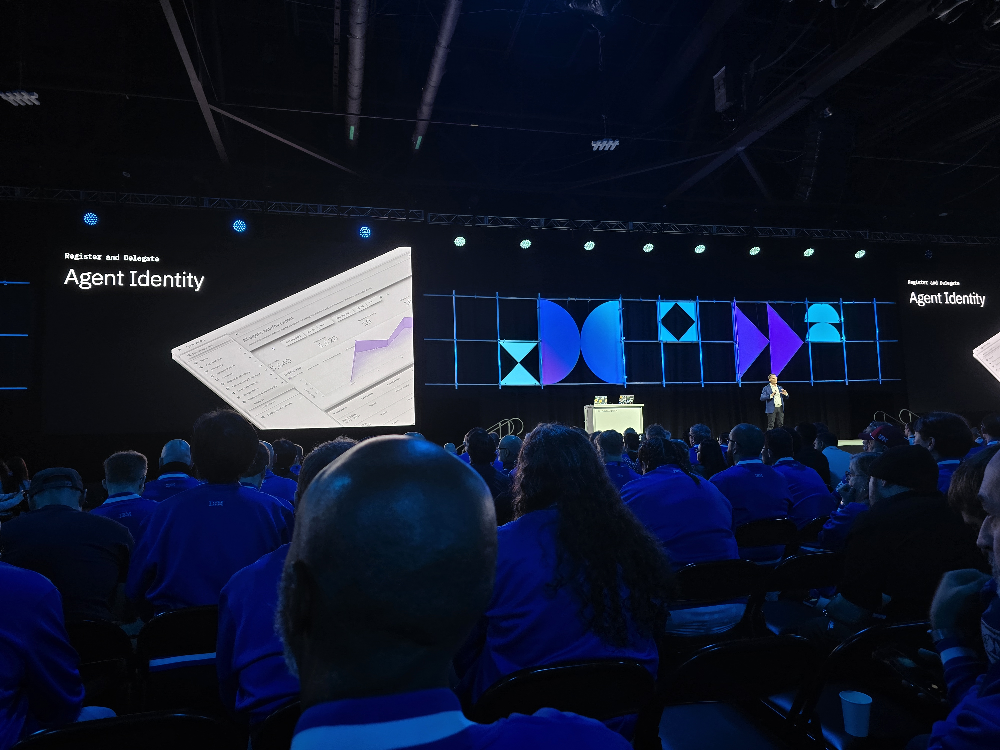
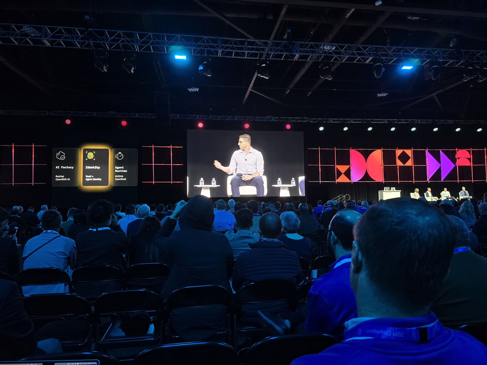
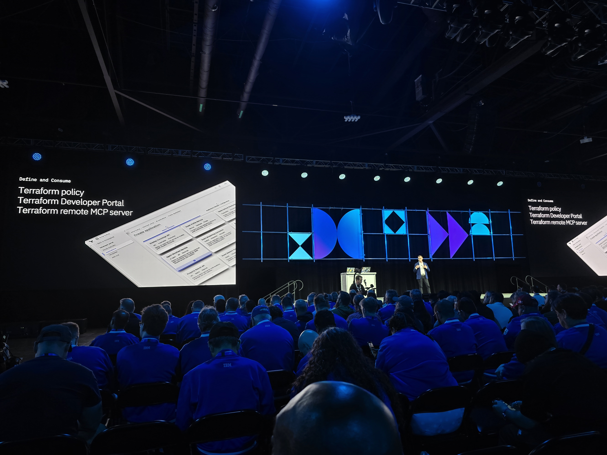
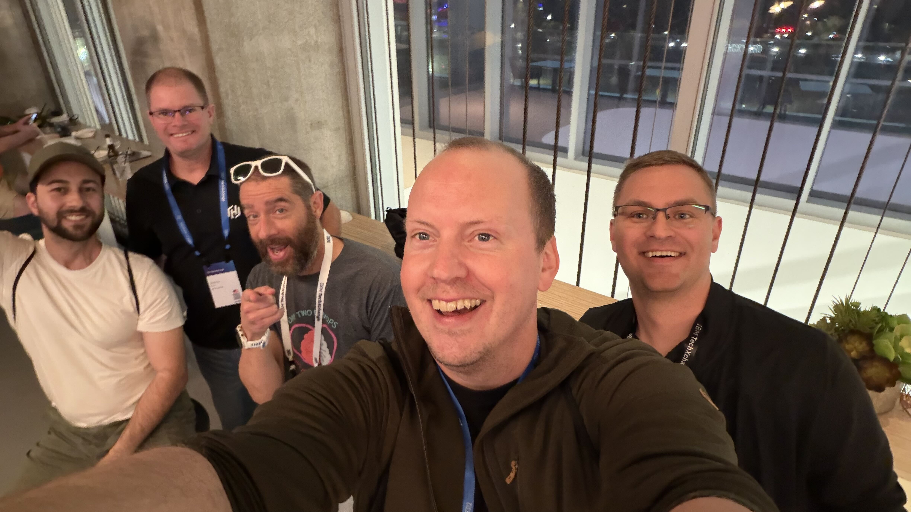

## Four days in Atlanta

From October 26 to 29, I attended IBM TechXchange 2026 in Atlanta, Georgia. As an IBM Champion and HashiCorp Ambassador, it was the first year that HashiConf is incorporated into TechXchange, bringing the HashiCorp community together with practitioners from across IBM. Four days at a technology conference can be a lot to take in, but this year's announcements gave me a clear theme to follow: how do we give AI agents useful access to business systems without losing control of what they can do?

That question connected several HashiCorp announcements, especially around Vault and Terraform. Rather than treating AI agents as just another application, the news focused on their identity, credentials, permissions, and the infrastructure changes they may carry out. What follows is my personal read on the announcements.

## Giving AI agents an identity and limited access

One of the main announcements was the extension of HashiCorp Vault capabilities to AI agents. Agents can receive secured, short lived credentials with access limited to what they need. The goal is to reduce reliance on long lived credentials and make it possible to revoke access when an agent's authority or risk changes.

IBM also described Agent Identity, now generally available, as a way to maintain an authoritative record for each agent, including who owns it, its lifecycle status, and the authority it has been granted. Used with Vault, that identity context can help enforce least privilege and support real time revocation when an agent attempts an unauthorized action.

{: .left }

 

{: .left }

                                         

This direction stood out to me because it treats agents as identities that need lifecycle management, not as invisible background processes. As agents gain the ability to call tools and interact with enterprise systems, knowing which agent acted and what it was allowed to do becomes essential.

## Vault updates

The announcement also highlighted **Vault 2.2**, which gives agents secured accounts, automatically renews their credentials, and incorporates post quantum encryption. **Secure Hub**, described as a public preview, provides centralized visibility across Vault environments to help teams understand operational health, usage, and security resources.

The event also featured customer sessions from organizations using HashiCorp products. Topics included certificate management with Vault's PKI engine, detecting exposed secrets with Vault Radar, identity based access with Boundary, and secrets management for enterprise applications. Those examples helped ground the announcements in familiar operational work, rather than presenting agent security as a completely separate discipline.

## Terraform and governed infrastructure changes

Terraform was another important part of the HashiCorp news. IBM described Terraform Policy, Terraform Developer Portal, and the Terraform remote MCP server as capabilities that let developers and AI agents work with approved configurations and established controls. Terraform Policy is now generally available, while the Terraform Developer Portal and the Terraform remote MCP server are in public preview.

{: .left }

                     

## Why being there still matters

You can read every announcement in a press release, and replays will eventually be online. So why fly to Atlanta? Because the most valuable parts of an event like this rarely make it into a blog post or a recording.

TechXchange is much more than keynotes. There are technical sessions, hands-on labs, customer talks, product demos at the expo floor, community meetups, certification exams, and plenty of informal moments in between. During the day you jump from a deep dive on Vault to a lab on Terraform, stop by a booth to ask a product team a hard question, and end up in a conversation you never planned. No one can attend everything, and that is part of the lesson. Choosing your sessions with intent, and leaving room for the unexpected, makes a big difference in what you bring home.

**The hallway track is real.** Some of moments happened between sessions: a quick chat after a talk, a coffee with someone facing the same problem I had seen in a project, or a conversation at a booth that turned into twenty minutes of whiteboarding. Hearing how other teams run Vault and Terraform in production, what broke, and what they would do differently is something no documentation can replace.

**Networking is about people, not business cards.** Meeting other IBM Champions, HashiCorp Ambassadors, product managers, and engineers in person turns online names into real relationships. Those are the people you message later when you are stuck, and the ones who give honest feedback on your ideas. As a community member, I also get to bring feedback directly to the product teams, and seeing that feedback taken seriously is one of the most rewarding parts of these programs.

**Client stories teach more than demos.** Product demos show what is possible. Customer sessions show what is practical.

**Hands-on labs and certifications are worth the time.** Labs are a low risk way to try new features before they reach your environment, especially those still in preview. Having certification exams available on site is also a great opportunity to validate knowledge while you are already immersed in the subject.

**You come back with perspective.** Day to day, it is easy to focus only on the next ticket or deployment. Stepping away for a few days and listening to where the industry is heading helps me prioritize what to learn next and what to recommend to the teams I work with.

**Being present changes the conversation.** Showing up in person signals commitment to the community. Product teams remember the people who stop by, ask thoughtful questions, and share real use cases. Peers remember who they had lunch with. That presence builds trust in a way that a comment on social media or a message on a forum rarely does.

If you have the chance to attend an event like TechXchange, my advice is simple: plan the sessions you cannot miss, talk to people you do not know yet, ask questions after the talks, take notes you can share with your team, and follow up with the contacts you made.

{: .left }

                

## What I took away

Across the announcements, I saw a consistent message: AI agents need to be governed through the same practical controls we expect for other parts of our infrastructure. They need a known identity, limited permissions, credentials that can be rotated or revoked, and a clear process for making changes.

Reference: [IBM Newsroom: IBM introduces identity and control for AI agents](https://newsroom.ibm.com/2026-10-27-ibm-introduces-identity-and-control-for-ai-agents,-securing-frontier-intelligence-for-the-enterprise)