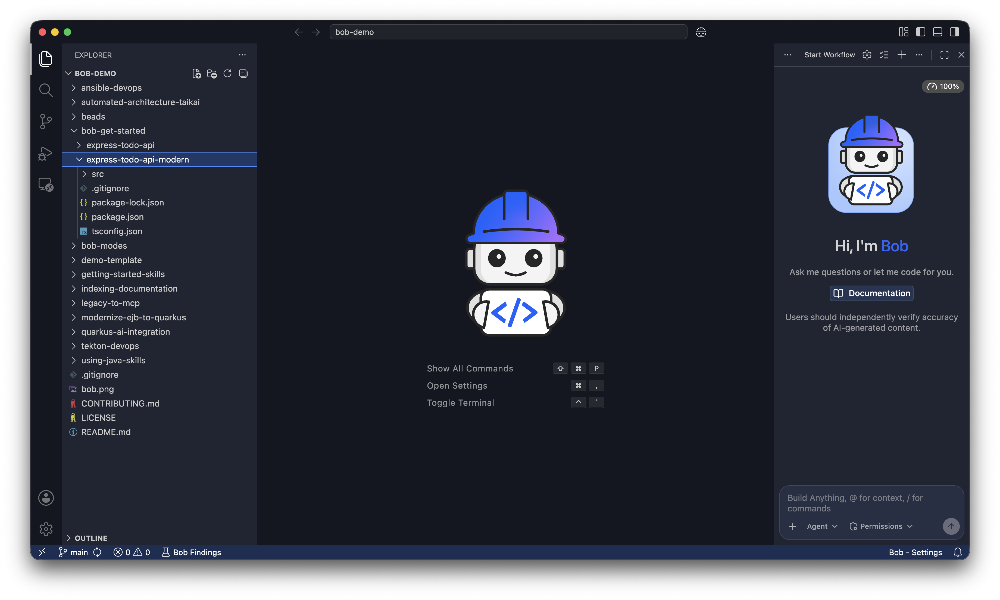
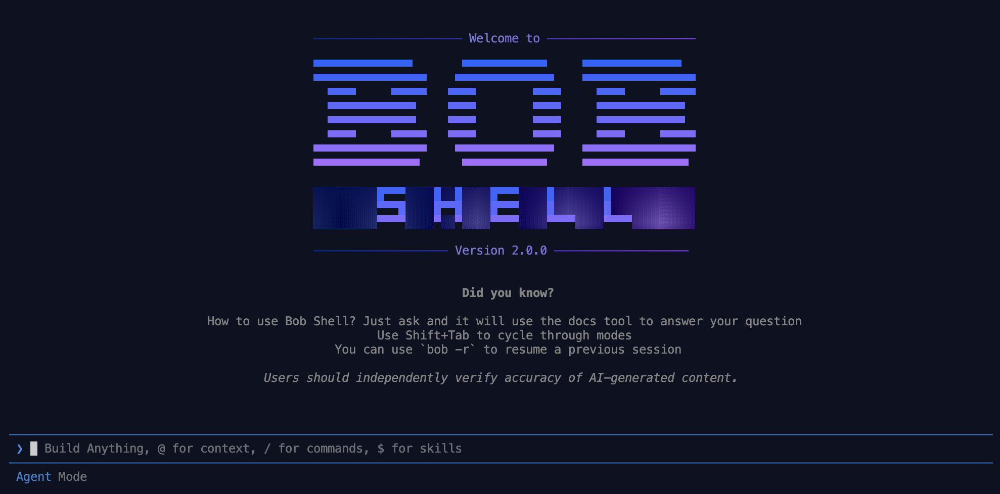
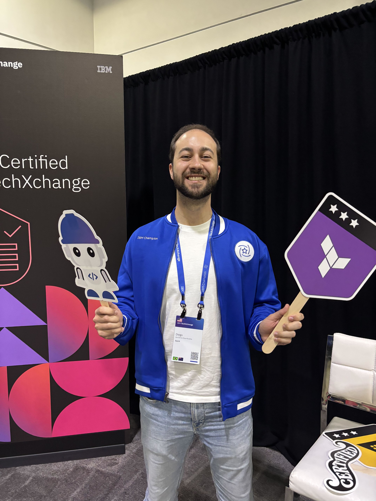
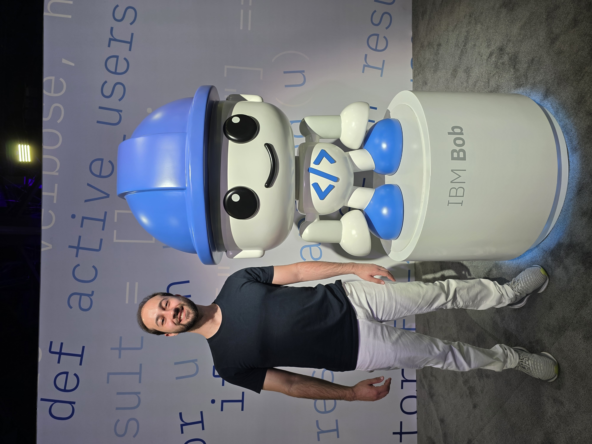

At IBM TechXchange 2026, Bob came up repeatedly in sessions, demos, and hallway conversations. I already knew about its introduction at TechXchange 2025, although I did not attend that edition. Seeing more of it in 2026 made me curious to explore the product. I also took its developer certification exam at the event and passed.

This post is a starting point for anyone who has never used Bob: what it does, how you interact with it, and what to explore next. The official references are collected at the end.

## What is IBM Bob?

IBM describes Bob as an **AI SDLC partner**, where SDLC means *Software Development Lifecycle*. In plain terms, it is an AI development assistant designed to help you understand, change, test, and maintain software, rather than only suggest the next line of code.

You describe a task in natural language, and Bob can use project context and tools to work on it. That might mean explaining an unfamiliar repository, planning a feature, fixing a bug, writing tests, or helping upgrade an older application.

This is what **agentic** means here: Bob can take actions, such as editing files and running commands, rather than only returning an answer. You still need to control permissions, review the changes, and check the test results.

## Clients: Bob IDE and Bob Shell

- **Bob IDE** is the graphical development application for macOS, Windows, and Linux. It brings the project files and AI conversation into the same environment.
{: .left }

- **Bob Shell** brings Bob to the terminal, for interactive conversations, command-line tasks, and scripts.
{: .left }

             

These are two ways to work with Bob, not two subscription tiers. The V2 architecture shares the underlying agent across clients. Bob also supports compatible editors through the **Agent Client Protocol (ACP)**, so you are not limited to those two interfaces.

Installing a client on your computer does not mean its AI models run locally. The standard setup requires internet access; self-hosted deployment is a separate Enterprise option.

## What working with Bob can look like

Bob has three built-in modes:

| Mode | Purpose |
|---|---|
| **Ask** | Understand and analyze without changing code |
| **Plan** | Investigate requirements and prepare an implementation plan |
| **Agent** | Implement using tools and workspace context |

For example, imagine you have just joined a project and need to fix a bug:

1. In **Ask**, request an explanation of the relevant code and its existing tests.
2. In **Plan**, ask for a proposed fix and how to verify it.
3. Review the plan, then use **Agent** to implement the change and run the relevant tests.
4. Inspect the diff and test results before accepting the work.

This is an illustrative workflow, not a guarantee of a correct fix. Plan mode can create or edit Markdown and text files for planning; it is not entirely read-only.

As you go further, Bob supports custom modes, reusable skills, hooks for automation, and subagents for delegated tasks. It can also connect to external tools through **MCP (Model Context Protocol)**. You do not need to configure all of these to start exploring.

## A quick word on plans and usage

IBM offers a trial, individual plans, and Enterprise options. Usage is measured in **Bobcoins**, IBM's billing unit for the AI resources consumed. Think of them as a usage budget, not a fixed number of questions: one request can involve several steps, and consumption depends on the models and operations involved.

For a first evaluation, try a few small tasks and monitor the usage. Check the current allowance and any optional overage charges before enabling extra consumption. Prices and commercial terms are better checked in the official pages than copied into an overview.

Enterprise adds team administration and shared usage management, with IBM-managed SaaS and self-hosted deployment options. Self-hosted Bob runs on Red Hat OpenShift and supports disconnected environments with the appropriate setup; it is not an offline switch for an individual subscription.

There are also **Premium Packages** for DevSecOps, Java modernization, IBM i, and IBM Z. These are specialized add-ons to a base subscription, worth exploring if you work in those areas.

## The certification: IBM Certified Bob v2 Developer - Associate

Taking and passing the **IBM Certified Bob v2 Developer - Associate** exam was another part of my TechXchange experience.

{: .left }

According to IBM, it validates foundational skills in prompting, using Bob across development tasks, configuring custom modes and integrations, delegating work, and using the product securely and responsibly.

It is associate level, intended for candidates with at least six months of hands-on experience with the product.

My honest take: the exam will not make you an expert, but preparing for it forces you to explore parts of the product you might otherwise skip, like custom modes and the governance features. If you are already using Bob, or evaluating it for your team, it is a reasonable way to structure that learning.

## My takeaway

TechXchange gave me a reason to look more closely at Bob, and the certification gave that exploration some structure. For someone starting out, my suggestion is simpler: choose a small task in a project you know, ask Bob to explain it, then try a planned change.

Judge the result by whether you understand the code better and whether the change holds up under review and testing, not just by how much code it generates.

{: .left }

                                     

---

**References:**  
[IBM Bob product overview](https://www.ibm.com/products/ai-coding-agent)  
[Installing Bob IDE](https://bob.ibm.com/docs/ide/getting-started/install)  
[Bob Shell documentation](https://bob.ibm.com/docs/shell)  
[Ask, Plan, and Agent modes](https://bob.ibm.com/docs/ide/features/modes)  
[Bob V2 architecture and capabilities](https://bob.ibm.com/blog/bob-v2-release-announcement)  
[Editor integration through ACP and usage options](https://bob.ibm.com/blog/more-bobcoins)  
[Plans, pricing, and Premium Packages](https://www.ibm.com/products/ai-coding-agent/pricing)  
[Understanding Bobcoins](https://bob.ibm.com/docs/ide/account/bobcoins)  
[Self-hosted deployment overview](https://bob.ibm.com/docs/ide/enterprise/on-premises/overview)  
[IBM Certified Bob v2 Developer - Associate](https://www.ibm.com/training/certification/ibm-certified-bob-v2-developer-associate-C9010800)
